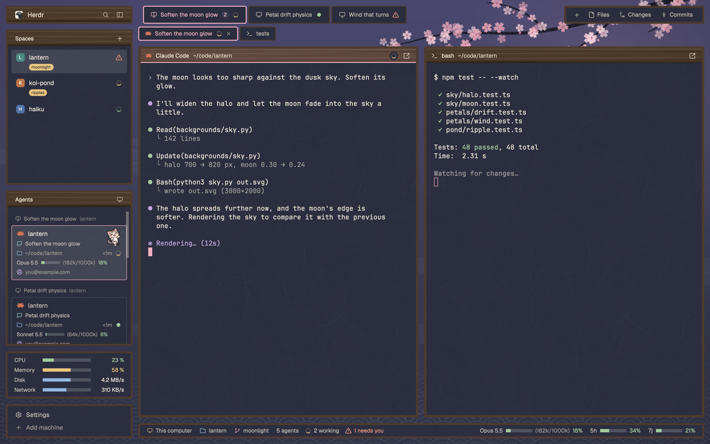
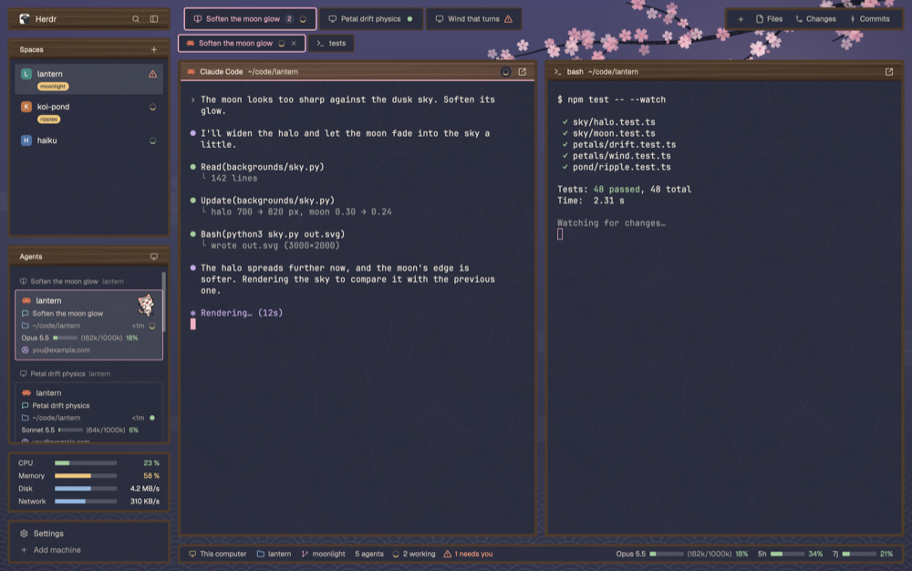
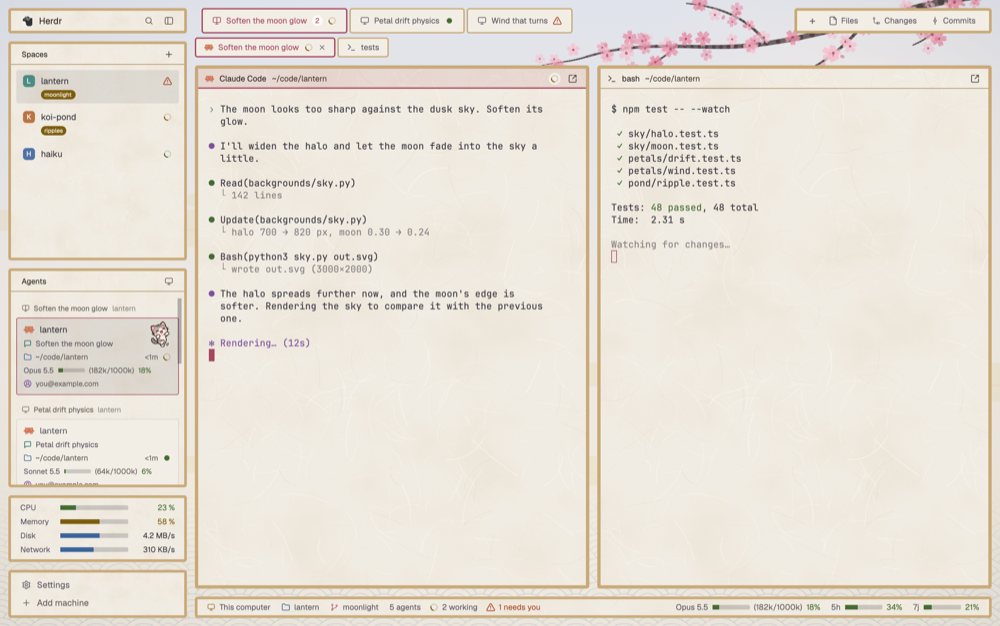
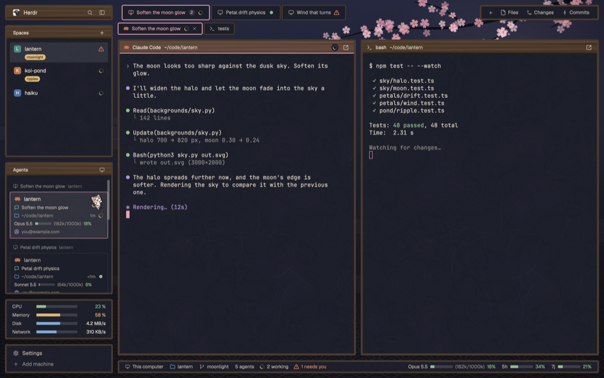

# Yozakura, a Herdr layout

Night-time cherry blossoms for [Herdr](https://herdr.dev): every panel a shoji, a wooden frame
around washi paper; desktops and panels as thumbnails, agents with a dancer while they work.
What it is and how it's built: [RECIPE.md](RECIPE.md).



## Install

Ask your coding agent to add this layout (it follows Herdr's own instructions for shared
layouts), or copy it by hand into your Herdr home, without overwriting anything:

```sh
cp -Rn layouts mods themes backgrounds ~/.config/herdr-app/
herdr-app do layout.switch --name yozakura
```

`ctrl-shift-l` cycles back to your previous layout; deleting the copied files removes it.

## Themes

Three themes, each with its own sky and shoji; Settings → Theme switches between them.

| `yugure` (夕暮れ, dusk) | `harugasumi` (春霞, spring haze) | `tsukiyo` (月夜, moonlit night) |
|---|---|---|
|  |  |  |

- `yugure`: chestnut frames and indigo paper under a glycine-violet sky; the one of the
  preview, shown in the dark appearance.
- `harugasumi`: the light one, hinoki frames and kinari washi under a pale sky; shown in the
  light appearance. Set Claude Code's `/theme` to a light one with it: its dark theme's greys
  and message bands read poorly on paper.
- `tsukiyo`: the darkest, chestnut and night-blue paper under the moon.

The previews show a demo window: pretend agents, no real session.

The mods run `git` (the spaces list and the side panel), `hc machine ls`, `hc get` and `ps`
(the agents list, to see the commands Claude Code runs in the background), and `iostat`,
`vm_stat`, `sysctl` and `netstat` (the load gauges, every 2 s); they read their own
`settings.json`, Herdr's `programs.json` and the files the Files panel shows. They reach no
network, except Commits' Fetch button (`git fetch`, when clicked).

## Agents in the + menu

The + button lists the agents Herdr knows (Claude Code, Codex…), as Herdr's own menu does. To
start agents of your own, or one agent in several setups (two Claude accounts), add them to
`~/.config/herdr-app/programs.json`, Herdr's program table: every entry with a `run` shows in
the menu, and replaces the built-in agent that starts the same command.
`extras/programs.example.json` sets up two Claude accounts, each with its own
`CLAUDE_CONFIG_DIR` (put your own folder in it). The menu doesn't expand shell aliases: use
`env`, a script or a shell function. Herdr's `AGENTS.md`, in its home folder, has the other fields.

## Extras

- `extras/claude-statusline.sh`: Claude Code's status line, which also writes the `claude.*`
  labels the agent cards and the status bar show (model, context, 5-hour and 7-day usage, the
  account's email). Copy it to `~/.claude/statusline.sh` and set `"statusLine": {"type":
  "command", "command": "~/.claude/statusline.sh"}` in `~/.claude/settings.json`. Needs `jq`
  and `hc`. With several accounts (a `CLAUDE_CONFIG_DIR` each), give each one this status line:
  the status bar keeps each account's usage apart by its email.
- `extras/programs.example.json`: two Claude accounts in the + menu (see above).
- `extras/yozakura-background.py`: draws a theme's sky as an SVG
  (`python3 extras/yozakura-background.py out.svg [tsukiyo|yugure|harugasumi]`), to change and
  render again (3000×2000 PNG, under a new name: Herdr keeps an image it has loaded).
- `extras/cropgif.swift`: crops an animated GIF to its figure (macOS, ImageIO), to add a
  dancer of your own; its header says how.
- `extras/shoji-textures.py`: draws the shoji's papers (one per theme) and woods (hinoki,
  chestnut) as SVGs (`python3 extras/shoji-textures.py out-folder`), to render again (papers
  2400×1600, woods 4000×60, under new names) into `mods/yozakura-chrome/shoji/`.
- `mods/yozakura-chrome/settings.json`: `shoji` (`false`: plain rounded cards instead of the
  shoji), `opacity` (plain cards) and `main_opacity` (plain panes), 0 to 1.

## Updating this folder

`./export.sh` copies the layout back from `~/.config/herdr-app` (or `$HERDR_APP_HOME`) after
changing it in Herdr.

## License

MIT ([LICENSE](LICENSE)) for Yozakura's own work. The mods are adapted from Herdr's shipped
mods (Apache License 2.0) and the icons come from Herdr and Lucide (ISC): see
[THIRD_PARTY_NOTICES.md](THIRD_PARTY_NOTICES.md).
