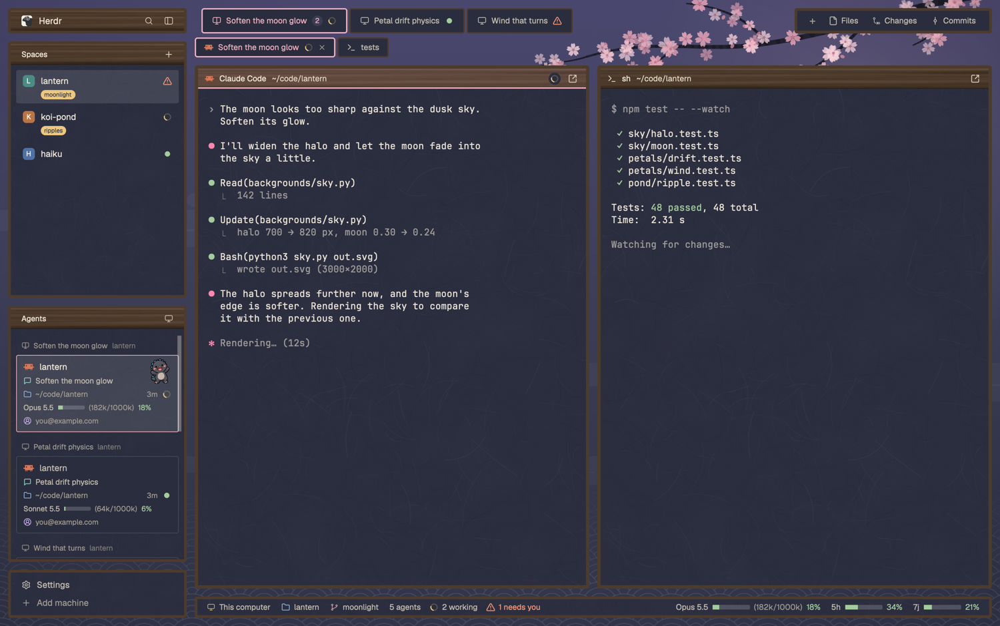

# Yozakura

A cherry-blossom window for coding agents: every panel is a shoji, a wooden frame around washi
paper, over a sky with a blossoming branch and falling petals. The sidebar lists spaces
and agents (a small dancer plays on every agent that works); the top bar shows one thumbnail per
desktop (the panels docked together) and, under it, one per panel of the shown desktop; the
focused panel's title bar is tinted pink.



## What you see

Left to right: a sidebar, then the work column. The window has no system title bar (macOS
traffic lights at 12,16); the root has 12 px padding and 12 px gaps everywhere. Behind
everything, the theme's sky (`backgrounds/<theme>.png`, 3000×2000, `cover`): a sky, a pale moon
(by day, a pale sun) top right, a cherry branch across the top, mist bands, falling petals,
seigaiha waves at the bottom.

Every card is a shoji (`yozakura-chrome/settings.json`: `shoji`, on unless `false`): a frame
of plain wood (5 px around panes, 4 px around cards, 4 px radius) around the theme's washi
(`mods/yozakura-chrome/shoji/paper-<theme>.jpg`, `cover`), and title bars that are rails of
grained wood (`wood-hinoki.png` for Haru-gasumi, `wood-kuri.png`, dark chestnut, for the
others) with a 1 px darker line under them. Corners inside (agent cards, space rows) are
nearly square (3 px). Without shoji: 14 px radius, a 1 px `border`, filled with the theme's
color at 85 % opacity (`opacity`, and `main_opacity` for the panes).

- **Sidebar** (268 px, 44–480): four cards, 12 px apart.
  - Brand (38 px): the Herdr logo and "Herdr"; Search (opens `picker`) and the sidebar toggle.
  - Spaces (half of the rest): a header with +; one row per space, a letter avatar in a muted
    Japanese pigment (`#4a8c84`, `#b97446`, `#4f72a6`, `#7c68ad`, `#5c8e5e`, `#b45a72`), its name,
    and only what's unusual under it: a yellow pill with branch and ↑/↓ counts. Worktree spaces
    sit under their repo's space; spaces are grouped by machine once another machine is known.
  - Agents (half of the rest): "Agents" and a sort button (screen: grouped by desktop, the
    default; clock: by priority in sections Needs you / Done / Working / Idle; layers: grouped by
    space). By desktop, the groups follow the bar's order; each header has the desktop's screen
    icon (split for several panels), its name and, once there are several spaces, its space's
    name. One card per agent: program icon and space name; the session's title after a speech
    bubble; the folder (cut at its start), a terminal icon and a count when commands run in its
    background (Claude Code), how long in this state, the status; for Claude Code, its model and
    a context gauge (green < 50 %, yellow < 80 %, red), then the account's email under a person
    icon. The shown agent's card is outlined in the accent. Sub-agents hang under
    their parent with tree lines. While an agent works, an animated dancer (one of seven:
    Godzilla, a cat, a maiko, a teddy bear, a samurai, a salaryman, a kabuki actor;
    `yozakura-agents/dancers/*.gif`) plays in its card's top right, 4 px from the top and 8 from
    the right, 40 px high at its own width (34 to 40 px). Each agent keeps its own,
    picked by its number (`seq`), so agents started one after another get different ones.
  - Footer (72 px): Settings, Add machine.
- **Top bar** (38 px; 74 px when the shown desktop has several panels):
  - One pill per desktop (a Herdr tab): a screen icon (whole for one panel, split for several),
    its name, a count badge for several panels, the most urgent status; the shown one outlined
    and colored in the accent, with × when it has a single panel.
  - On the right, a card: + (new terminal or agent, `yozakura-new-menu`), Files, Changes, Commits
    (window buttons too where the system draws none).
  - Under it (30 px), when the shown desktop has several panels: one pill per panel (program
    icon, session title or program name, status); the focused one outlined in the accent, with ×.
- **Panes**: the shown desktop's panels as cards (12 px gap), terminals with 16×14 px padding
  over the washi. Each has a 30 px header, the door's top rail: program icon, name, folder,
  status (on a disc of the theme's background, so its colors read on the wood), an undock button
  when docked with others; on hover split right, split down, zoom, close. The focused panel's
  rail is warmed with 12 % of the accent, has a 2 px accent line under it and a semibold name
  (without shoji: tinted with 32 % of the accent, an accent line under it).
- **Shoji inks**: text on the wood takes the kit's inks, at least 4.5:1 on its grain: on hinoki
  `#2f261f` and `#4a3b2e`, on chestnut `#f1e8d8` and `#e2d6c2`. The brand card is one rail from
  end to end; Spaces and Agents have a 31 px rail as their header; the desktop and panel
  thumbnails are paper plaques in a 2 px wooden frame (the accent for the shown one), the
  bar's buttons a paper card in a 4 px frame.
- **Side panel** (368 px, hidden until opened from the bar): Files, Changes or Commits.
- **Status bar** (32 px): the folder and branch of the terminal in view; how many agents, how
  many work, how many wait for you; Claude's context window, 5-hour and 7-day usage as gauges
  (the usage of the shown agent's account).

Three themes (`themes/<name>.json`), each with its sky; the layout shows Haru-gasumi in the
light appearance and Yūgure in the dark one (`"theme": {"light": "harugasumi", "dark":
"yugure"}`), and Settings → Theme picks any of them for either:

| Theme | Cards, terminals | Text | Secondary text | Accent | Sky |
|---|---|---|---|---|---|
| `tsukiyo` (月夜, moonlit night) | `#1c1e29` | `#ddd5c5` | `#bdb6aa`, `#948e85` | `#e9a3b5` | night, `#262940` to `#14151d` |
| `yugure` (夕暮れ, dusk) | `#2a2d3d` | `#ebe4d6` | `#c3bcb0`, `#a29c93` | `#efb0c0` | glycine violet, `#4b4870` to `#34364b` |
| `harugasumi` (春霞, spring haze, light) | `#f3eee5` | `#3a3741` | `#5c5763`, `#6a6462` | `#a5455e` | pale haze, gold mist, a pale sun |

Each sets the panels' text colors itself, in warm greys (Herdr derives neutral ones otherwise,
the dimmest at 3.2:1 on Tsukiyo's cards): every text and status color is at least 4.5:1
against the cards.

## How it behaves

- Statuses everywhere: working spins (`working` color), blocked shows a warning (`blocked`
  color), idle and done show a green dot. An idle or done Claude Code agent with commands still
  running in its background spins in green instead (agent cards, thumbnails, pane headers): it
  does nothing, but something runs. A space only speaks up when something in it needs you.
- Background commands: every 3 s, `yozakura-agents` lists the shells Claude Code runs its
  commands in (`ps`, arguments holding `shell-snapshots`) under each local Claude agent's
  process (`hc get`: `foreground.pid`). While the agent works, only shells older than its turn
  count: the others may be the turn's own. A command started during a turn therefore shows once
  the turn ends. Sub-agents running in the background don't show.
- The + menu: Herdr's agents, and the entries of `programs.json` with a `run`; a built-in agent
  that starts the same command as one of these is left out, so two Claude accounts read
  "Claude Work" and "Claude Personal" rather than three Claudes. Agents start in an unnamed
  desktop, which then shows the session's title.
- Desktops: a click on another desktop shows it (`tab.select`). A click on the shown one opens a
  name field under its thumbnail, focused with the name selected: Enter or leaving the field
  renames (empty: back to its default, the first panel's title), Esc or another click closes.
  Double-click opens Herdr's rename dialog. Drag a desktop onto another to reorder; drag a
  one-panel desktop onto a pane header to dock it. The wheel over the bar goes to the next or
  previous desktop.
- Panels row: click focuses that panel; drag it onto another panel's pill to swap them; drag it
  onto a pane header to dock it elsewhere; × closes it.
- Docking: while a desktop, a panel or an agent card is dragged, every other pane header turns
  into four zones (← Left, ↑ Top, ↓ Bottom, Right →); letting go on one (or clicking it) puts
  the terminal there. The undock button sends a docked panel back to a desktop of its own; the
  focus stays where it was.
- A terminal that loses its pane anyway (no tab, no keep, no parent) comes back in a desktop of
  its own after 10 s, with a toast that goes to it.
- Agents: click a card to show the agent; drag it to dock it; the pin (on hover) keeps it on
  top; the chevron folds its sub-agents. A finished agent you look at stays in Done until you
  leave it. Showing an agent (from its card, its pane or a shortcut) scrolls the list just
  enough to bring its card into view (its group's header when the group is folded); it does so
  again only when its card moves to another section, so scrolling away from it stays.
- Spaces: click to switch, right-click for the menu, drag to reorder, + for a new space (in the
  home folder).
- The side panel shown is remembered per space. The sidebar folds into a rail below 100 px
  (toggle in the brand card; » in the agents rail unfolds it).

## Built from

Layout `layouts/yozakura.json`, ids the mods rely on in **bold**:

```
root (row; background image, titlebar none, theme yozakura)
├─ **sidebar** (column 268 px)
│  ├─ brand        block  yozakura-chrome                 38 px, window_drag
│  ├─ sidebar-lists column
│  │  ├─ spaces    block  yozakura-spaces                 weight 1
│  │  └─ agents    block  yozakura-agents                 weight 1
│  └─ sidebar-footer block yozakura-chrome {footer:true}  72 px
└─ work (column)
   ├─ **tabs**     block  yozakura-tabs                   38 px (the mod resizes it), window_drag
   ├─ work-body (row)
   │  ├─ **main**  block  { tab: active, pane: header yozakura-pane 30 px, lone, radius 14 }
   │  └─ **panel** column 368 px, hidden → **panel-body** stack: files, changes, commits (git-history)
   └─ status       block  yozakura-status                 32 px
```

Mods (each `place: "none"`):

- `yozakura-chrome`: the brand card and, with `{footer: true}`, the footer. The brand copy reads
  its own `settings.json` (`readTextFile` + `watchFolder`), shares `yozakura.opacity`,
  `yozakura.mainOpacity` and `yozakura.shoji` (the theme's shoji kit: textures, frame color,
  inks; null when off), and rewrites the layout (`layout.set`) to match the theme shown: its
  sky on the root; with shoji, the frame and washi of the main pane and of the cards `brand`,
  `spaces`, `agents`, `sidebar-footer`, `status` (`SHOJI`, `CARDS`), else the main pane's faded
  background and the thin borders; checked every second, so a theme picked in Settings brings
  its sky and its shoji.
  Holds the shared icons (Lucide-style SVGs) the other mods use.
- `yozakura-spaces`: spaces list; runs `git status`/`rev-parse` (`exec`, on the space's machine)
  and `hc machine ls`; watches the repos it shows.
- `yozakura-agents`: agents list, sort popup (`props: {sortMenu: true}`), dancers, the safety
  net that brings lost terminals back (`terminal.keep`), the background commands' scan (`exec`
  of `ps`, `hc get`).
- `yozakura-tabs`: the bar; also the desktop name field (`props: {desktop}`, a popup).
- `yozakura-pane`: pane headers, drop zones, dock (`terminal.park` + `terminal.keep` +
  `pane.swap`) and undock.
- `yozakura-status`: the status bar.
- `yozakura-new-menu`: the + popup; reads `programs.json` (`readTextFile`).

Shipped mods used: `files`, `changes`, `git-history`, `menu`, `picker`,
`machine-add`, and `frame/welcome/herdr.png`.
Shared keys: `yozakura.opacity`, `yozakura.mainOpacity`, `yozakura.dock.drag`,
`yozakura.dock.undock`, `yozakura.agents.sort`, `yozakura.background` (address → count of
background commands), `yozakura.shoji` (this layout's); `sidebar.width`, `sidebar.collapsed`, `space.colors`,
`workspace.panels`, `new-menu.agents` (shared with the shipped mods on purpose).
Claude figures: `claude.*` labels on each Claude Code terminal, written by
`extras/claude-statusline.sh` (Claude Code's `statusLine` command; needs `jq` and `hc`);
`claude.email` comes from the account's `.claude.json` and tells accounts apart.
Art: `backgrounds/{tsukiyo,yugure,harugasumi}.png` (drawn by `extras/yozakura-background.py`,
which writes the SVG, one sky per theme), the seven dancer GIFs (9 frames at 160 ms, looping, transparent; each cropped
to its figure over all its frames by `extras/cropgif.swift`, 315 to 355 px wide), the screen icons,
the shoji's textures (`mods/yozakura-chrome/shoji/`, drawn by `extras/shoji-textures.py`: papers
with faint mottling and fibers, woods with their grain along them, seamless end to end).

## Watch out

- A pane's frame takes one color (`border`), no image: the shoji's sides are plain wood; only
  the rails (drawn by mods) show the grain. The washi comes from the layout (`background:
  {image, fit: "cover"}` on the pane frame and the card blocks), so a mod over it draws no fill.
- `image()` keeps its picture's proportions: the rails show the wood as strips sized at its
  4000×60 proportions (`h × 66.7` wide, `h` tall), two side by side, cut by the header.
- Text over the textures: their darkest (light theme) or lightest (dark ones) 1 % of pixels
  were measured, and the fibers toned down until every text color stays at 4.5:1.
- Herdr keeps an image it has loaded: a sky drawn again must go under a new file name (and in
  `SKIES`, `yozakura-chrome`), or the window keeps the old one.
- A light theme picked in Settings goes in the layout's `light` half, a dark one in its `dark`
  half: the appearance (`appearance` in settings.json, else the system's) decides which shows.
- Claude Code draws with its own theme: on Haru-gasumi, its dark theme's greys and the bands
  behind your messages read poorly; its `/theme` has light ones.
- `terminal.park` answers at once but the core finishes later: wait until the terminal has no
  pane **and** no `herdr.tab` label before `terminal.keep`, then until it has both again.
  A `keep` sent earlier is lost and the terminal ends up in no tab and no list.
- A pane header's tasks die with its pane: an undock run from the clicked header stops right
  after the park. The clicked header only queues the request (`yozakura.dock.undock`); the header
  of a pane that stays picks it up on a 100 ms timer (timers run in hidden copies, key commands
  don't reach them) and runs the move. A dock runs in the header it was dropped on, which stays.
- `cx.spawn` from `render` does nothing; only init, handlers, timers and tasks can start work.
- The bar's second row exists only through `layout.resize` on `tabs` (38 ↔ 74 px), done from
  the bar's render when the shown desktop's panel count crosses 1; keep the ids `sidebar`, `tabs`,
  `main`, `panel`, `panel-body`.
- `main_opacity` works by rewriting the layout (`layout.set`): it needs a personal layout, not a
  shipped one.
- A desktop Herdr made for a terminal (`terminal.keep`) is "named" after its program or address;
  treat that as unnamed.
- GPUI plays animated GIFs in `image()` by itself: no timer for the dancers.
- The dancers move across their frames: crop each GIF once for all its frames (the union of
  their opaque pixels), never frame by frame, or the dance jumps. Slim figures then come out
  taller than wide: give each its own box (40 px high, its crop's width, `DANCERS` in
  `yozakura-agents`) rather than one box for all, which would leave them small.
- A popup opened under a thumbnail uses the release event's `bounds` (window coordinates).
  Pressing the thumbnail again closes the popup before the release: remember when it closed
  (its `close()`), or the release reopens it.
- Built and used on macOS; the window buttons drawn on Linux and Windows are untested.
- Without the status line script, the agent cards and the status bar simply leave out Claude's
  model and gauges.

## Previews

`preview.png` and `previews/*.png` come from a demo window (`herdr-app shot`), never from a
real one (agent cards show account emails):

- its own home, at a short path (`HERDR_APP_HOME=/tmp/yzh`: the control socket's path has a
  length limit), seeded with the layout, mods, themes, skies and a `window.json` of 1500×940;
- its own core: `HC_SESSION` plus scratch `XDG_STATE_HOME`, `XDG_CONFIG_HOME` and
  `XDG_RUNTIME_DIR`. On a shared core, each window adopts the other's terminals (an unknown
  `herdr.space` becomes a new space);
- `HERDR_RELEASES_URL` pointed nowhere, or an update pill covers the status bar;
- pretend agents: a script that prints a title (OSC 2), a status (OSC 7501
  `app=claude-code:state=working`) and a transcript wrapped to the pane's columns, with
  `claude.*` labels set by `hc label` (`you@example.com`), in small git repos under `~/code`;
- the brand card without the traffic lights' room (the shot leaves the system buttons out);
- closed with `app.quit`, not killed: a killed window installs a waiting update at its next
  start, and the app is the person's too.

## Done when

- `herdr-app check` passes for the seven `yozakura-*` mods; `layout.switch {name: "yozakura"}`
  shows the window above with no `layout.error` and no error in `herdr-app status`.
- Settings shows the layout with its preview; Settings → Theme offers `tsukiyo`, `yugure` and
  `harugasumi`, and picking one puts its sky behind the cards within a second.
- An agent that works has a dancer on its card; it goes when the agent stops.
- With two panels in the shown desktop, the bar is 74 px with a pill per panel; with one, 38 px.
- Clicking the shown desktop opens its name field; typing a name and Enter renames it.
- Undocking a panel puts it in its own desktop within a second, its thumbnail appears in the
  bar, the focus stays on the panel it left, and no "Terminal brought back" toast follows.
- With shoji, every pane and card has a wooden frame around washi and the panes' headers are
  rails of grained wood; the focused one has the accent line. In Haru-gasumi the wood is pale
  hinoki, in Yūgure and Tsukiyo dark chestnut on indigo paper. `"shoji": false` brings back
  plain rounded cards within a second.
- Focusing the pane of an agent whose card is scrolled out of the list brings the card into view.
- With `extras/programs.example.json` as `programs.json`, + offers Claude Work and Claude
  Personal, and no Claude Code.
- A Claude Code agent that ends its turn with a command in the background (`sleep 60`) spins
  in green, its card counts 1, within 3 s; both go when the command ends.
